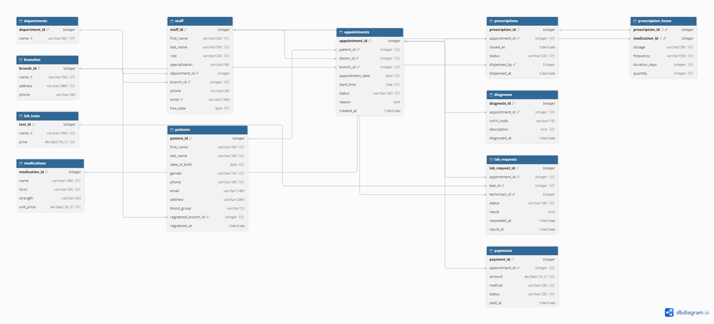
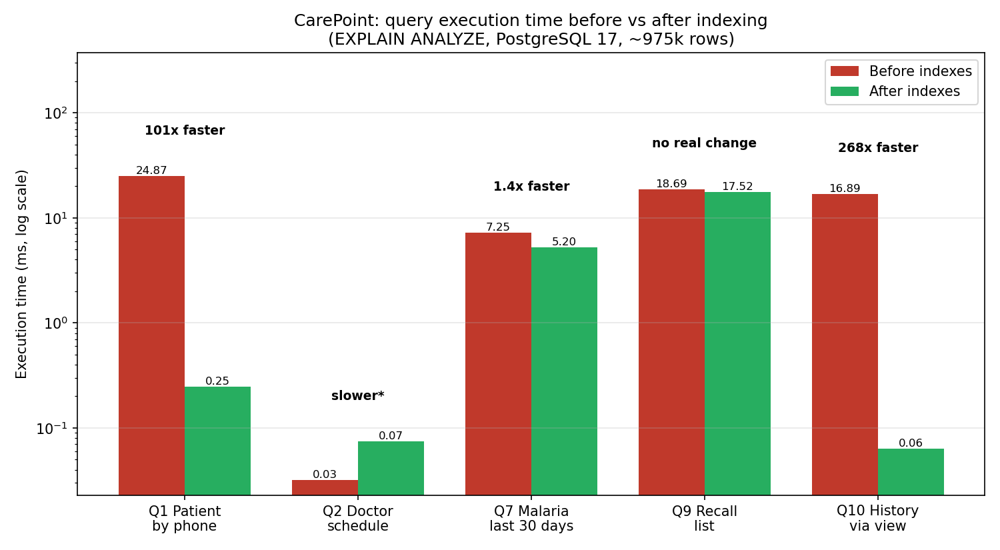
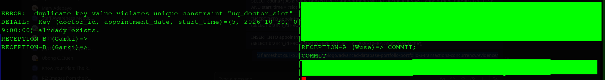
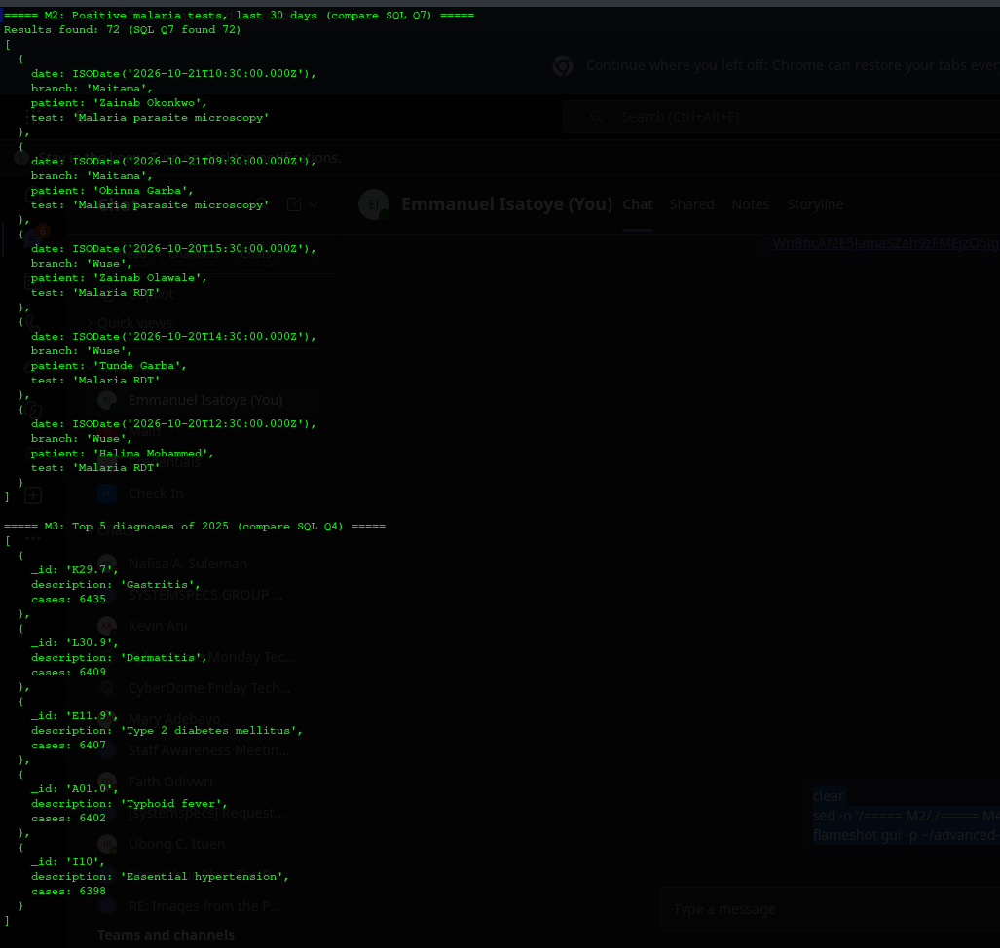

# Advanced Database Systems Portfolio: CarePoint Family Clinic, Abuja
 
**Course:** MIT 8103 Advanced Database Systems, MIVA Open University (2026/2027, First Semester)
**Student:** FaithEjiro
**DBMS:** PostgreSQL 17 (relational), MongoDB (NoSQL), on Parrot OS
 
## Case study
 
CarePoint Family Clinic is a simulated outpatient healthcare provider in Abuja, Nigeria, with three branches: **Wuse, Garki and Maitama**. The database supports patient registration, appointment booking (with double-booking prevention), diagnoses, prescriptions, pharmacy stock, laboratory tests and payments. Full statement: [Portfolio 1](portfolio-1-database-design/README.md).
 
## Portfolio at a glance
 
| # | Portfolio | Status | Headline result |
|---|---|---|---|
| 1 | [Database Design and Modelling](portfolio-1-database-design/README.md) | Complete | 12-table schema in 3NF/BCNF; 7/7 constraint tests passed |
| 2 | [Query Processing and Optimisation](portfolio-2-query-optimisation/README.md) | Complete | Up to **268x faster** queries after indexing ~975k rows |
| 3 | [Transactions and Concurrency](portfolio-3-transactions-concurrency/README.md) | Complete | Double-booking and lost-update problems shown live and prevented |
| 4 | [NoSQL and Advanced Data Models](portfolio-4-nosql/README.md) | Complete | 20,000 patient files as MongoDB documents; results match SQL exactly |
| 5 | [Distributed and Cloud Databases](portfolio-5-distributed-cloud/README.md) | In progress | |
 
## Portfolio 1: Database Design
 

 
- **12 tables**: branches, departments, staff, patients, appointments, diagnoses, medications, prescriptions, prescription_items, lab_tests, lab_requests, payments.
- Normalised from a paper visit card (UNF) to **3NF/BCNF** ([explanation](portfolio-1-database-design/normalisation.md)).
- Integrity enforced by primary/foreign keys, CHECK constraints, business-rule constraints and a **partial unique index** that blocks double-booking but frees cancelled slots.
 
| Constraint test | Result |
|---|---|
| Doctor without specialisation | Rejected |
| Invalid blood group | Rejected |
| Patient at non-existent branch | Rejected |
| Double-booking a doctor's slot | Rejected |
| Re-booking a cancelled slot | Accepted |
| Negative payment | Rejected |
 
## Portfolio 2: Query Optimisation
 

 
- Realistic dataset: 20,000 patients and 225,068 appointments (Jan 2024 to Dec 2026).
- Ten business queries using joins, window functions, conditional aggregation, an anti-join and a view.
- Seven indexes (mainly on foreign keys, which PostgreSQL does not index automatically), costing ~18 MB.
- **Finding:** indexes gave 101x to 268x speed-ups for selective lookups, but almost none for queries that read a large share of a table.
 
## Portfolio 3: Transactions and Concurrency
 
Five demos, run as a script and live in two side-by-side sessions acting as staff at different branches:
 
| Demo | Problem | Protection | Outcome |
|---|---|---|---|
| 1 | 6-step consultation workflow | `COMMIT` | All steps saved together |
| 2a | Not enough stock halfway through | `ROLLBACK` | Every step undone, no trace left |
| 2b | Same failure | `SAVEPOINT` | Only dispensing undone; diagnosis kept, prescription `Pending` |
| 3 | Two receptionists book the same slot | Unique index + waiting | Second booking rejected |
| 4 | Two pharmacists dispense the last stock | `FOR UPDATE` / atomic update | Lost update prevented |
| 5 | Report reads change mid-task | `REPEATABLE READ` | Consistent snapshot |
 

 
- **Finding:** an application's "is it free?" check is never enough when two users act at once; database constraints and locks are the real protection. Constraints alone cannot stop a lost update, because the wrong value written can still be a valid one.
 
## Portfolio 4: NoSQL (MongoDB)
 
- Each patient stored as **one document** with visits, diagnoses, prescriptions, lab tests and payments nested inside (20,000 documents, 0 import failures).
- MongoDB queries gave **exactly the same results** as the PostgreSQL queries (72 positive malaria tests; identical top diagnoses).
- Phone index: documents examined dropped from **20,000 to 1** (`COLLSCAN` to `IXSCAN`).
- **Finding:** documents suit reading a whole patient file and data that varies between patients; PostgreSQL stays better for bookings, stock and cross-patient reports.
 

 
## Repository structure
 
    advanced-database-portfolio/
    ├── portfolio-1-database-design/          ER diagram, schema, normalisation, constraint tests
    ├── portfolio-2-query-optimisation/       seed data, queries, execution plans, indexes, chart
    ├── portfolio-3-transactions-concurrency/ stock migration, transaction script, concurrency demos
    ├── portfolio-4-nosql/                    MongoDB export, document queries, index
    ├── portfolio-5-distributed-cloud/
    └── README.md                             this summary
