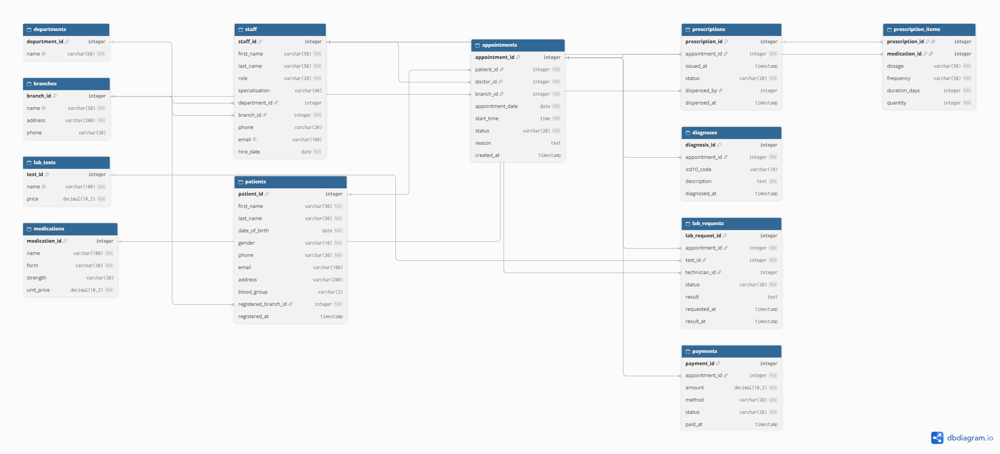

# Portfolio 1: Database Design and Modelling
 
## Case Study: CarePoint Family Clinic
 
**Organisation:** CarePoint Family Clinic is a simulated outpatient healthcare provider in Abuja, Nigeria, operating three branches: Wuse, Garki and Maitama.
 
**Nature of the business:** The clinic provides general consultations, specialist referrals, prescriptions and basic laboratory tests. Patients may visit any branch, so their records must be available clinic-wide.
 
**Database users:**
- **Receptionists:** register patients, book and cancel appointments
- **Doctors:** view patient history, record diagnoses, issue prescriptions, request lab tests
- **Lab technicians:** record test results
- **Pharmacists:** view and dispense prescriptions
- **Administrators:** manage staff, branches, departments and payments
 
**Major data stored:** patients, staff (doctors and other roles), branches, departments, appointments, diagnoses, prescriptions and medications, lab tests and results, payments.
 
**Key operations:** register a patient, book an appointment, prevent double-booking of a doctor's time slot, record a diagnosis, issue a prescription, record lab results, process a payment, and retrieve a patient's full medical history.
 
## Files in this folder
 
| File | Purpose |
|---|---|
| `carepoint_erd.dbml` | ER diagram source (dbdiagram.io / DBML) |
| `carepoint_erd.png` | Rendered ER diagram |
| `schema.sql` | PostgreSQL script creating all 12 tables, keys and constraints |
| `normalisation.md` | Normalisation from UNF to 3NF/BCNF, with design decisions |
| `constraint_tests.sql` | Test script proving the integrity constraints work |
| `evidence/` | Output files and screenshots from running the scripts |
 
## ER Diagram
 

 
## Relational Schema Summary
 
12 tables in four groups:
 
- **Reference:** `branches`, `departments`
- **People:** `staff` (all roles, including doctors), `patients`
- **Clinical:** `appointments`, `diagnoses`, `prescriptions`, `prescription_items`, `medications`, `lab_tests`, `lab_requests`
- **Billing:** `payments`
 
`appointments` is the central table: diagnoses, prescriptions, lab requests and payments all link to it. The many-to-many relationship between prescriptions and medications is resolved by the junction table `prescription_items`, which uses a composite primary key `(prescription_id, medication_id)`.
 
## Keys and Constraints
 
- **Primary keys** on every table, using `GENERATED BY DEFAULT AS IDENTITY` (the modern SQL-standard replacement for `SERIAL`).
- **Foreign keys** enforce every relationship; `prescription_items` cascades deletes from its parent prescription.
- **CHECK constraints** restrict roles, genders, blood groups, statuses and payment methods to valid values, and prevent negative prices and amounts.
- **Business-rule constraints:** every doctor must have a specialisation; a dispensed prescription must record the pharmacist and time; a completed lab test must have a result.
- **Partial unique index `uq_doctor_slot`:** a doctor cannot hold two active appointments at the same date and time, but a cancelled appointment frees the slot.
 
## How to Run
 
```bash
sudo -u postgres createdb carepoint
psql -U postgres -h localhost -d carepoint -f schema.sql
psql -U postgres -h localhost -d carepoint -a -f constraint_tests.sql
```
 
## Testing
 
`constraint_tests.sql` runs inside a transaction that is rolled back, so no data is kept. Results are in `evidence/constraint_tests_output.txt`.
 
| Test | Expected | Result | Enforced by |
|---|---|---|---|
| Doctor without specialisation | Reject | Rejected | `chk_doctor_specialisation` |
| Invalid blood group ("Z+") | Reject | Rejected | `patients_blood_group_check` |
| Patient at non-existent branch | Reject | Rejected | `patients_registered_branch_id_fkey` |
| Book a doctor's slot | Accept | Accepted | |
| Double-book the same slot | Reject | Rejected | `uq_doctor_slot` |
| Cancel, then re-book the slot | Accept | Accepted | Partial index condition |
| Negative payment | Reject | Rejected | `payments_amount_check` |
 
**Observations:**
- The rebooked appointment received ID 3, not 2: the failed insert consumed an identity value. PostgreSQL does not reuse sequence values after failures or rollbacks (to avoid blocking concurrent sessions), so gaps in IDs are expected.
- All timestamps inside the test transaction are identical, because `now()` returns the transaction start time.
