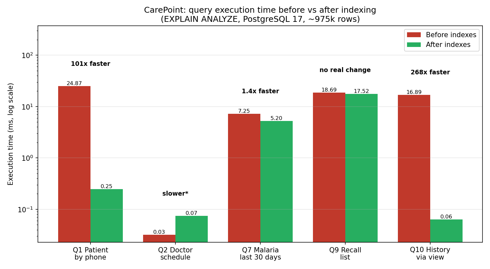
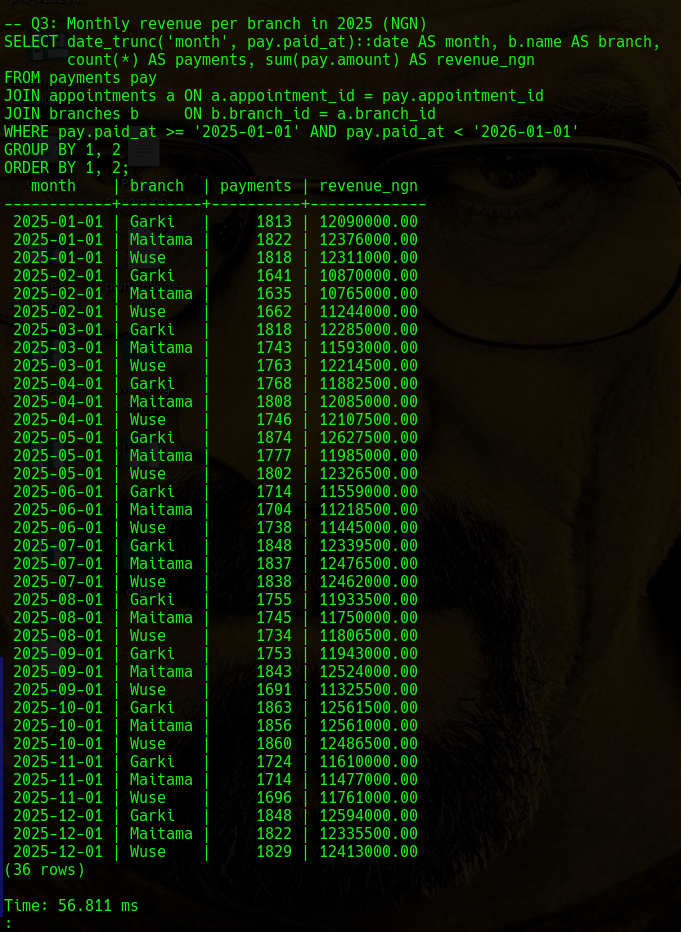
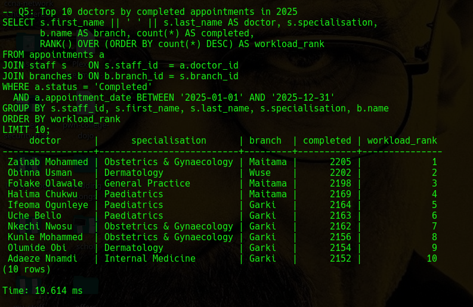
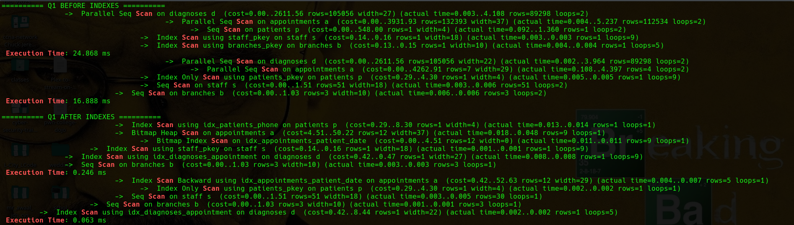

# Portfolio 2: Query Processing and Optimisation
 
This portfolio loads a realistic dataset into the CarePoint schema from Portfolio 1, runs ten business queries, analyses their execution plans, and measures the effect of targeted indexes.
 
## Headline results
 

 
| Query | Before (ms) | After (ms) | Result |
|---|---|---|---|
| Q1 Patient history by phone | 24.868 | 0.246 | **101x faster** |
| Q2 Doctor schedule | 0.032 | 0.074 | slower* |
| Q7 Positive malaria tests, last 30 days | 7.246 | 5.201 | 1.4x faster |
| Q9 Recall list (no visit in 12 months) | 18.686 | 17.520 | no real change |
| Q10 Patient history via view | 16.888 | 0.063 | **268x faster** |
 
Times are `Execution Time` from `EXPLAIN (ANALYZE, BUFFERS)`. \*See analysis below.
 
## Files in this folder
 
| File | Purpose |
|---|---|
| `seed_data.sql` | Reproducible data generator (~975,000 rows) |
| `queries.sql` | Ten business queries (Q1 to Q10), including a view |
| `explain_plans.sql` | `EXPLAIN ANALYZE` for the five index-sensitive queries |
| `indexes.sql` | Seven performance indexes, plus their disk sizes |
| `plot_performance.py` | Generates the before/after chart from the evidence files |
| `evidence/` | Row counts, query results, execution plans, index sizes, chart, screenshots |
 
## 1. Dataset
 
`seed_data.sql` uses `generate_series` and a fixed random seed (`setseed(0.42)`), so every run produces identical data. Appointments are generated from a grid of *doctor x working day x 30-minute slot* (Jan 2024 to Dec 2026, closed Sundays), which guarantees the double-booking rule is never violated. The snapshot date is 2026-10-21: later appointments are `Booked`; earlier ones are `Completed` (85%), `Cancelled` (8%) or `No-show` (7%).
 
| Table | Rows |
|---|---|
| branches / departments | 3 / 8 |
| staff (30 doctors, 21 other staff) | 51 |
| patients | 20,000 |
| appointments | 225,068 |
| diagnoses | 178,596 |
| prescriptions / prescription_items | 107,319 / 214,638 |
| lab_requests | 53,424 |
| payments | 178,596 |
 
## 2. Business queries
 
| # | Question | User | Technique |
|---|---|---|---|
| Q1 | Full visit history for a patient, searched by phone | Receptionist / doctor | 5-table join, LEFT JOIN |
| Q2 | A doctor's schedule for tomorrow | Doctor | Filter + sort on indexed columns |
| Q3 | Monthly revenue per branch, 2025 | Admin | `GROUP BY`, `date_trunc` |
| Q4 | Top 5 diagnoses of 2025 with % share | Management | Aggregate + window function |
| Q5 | Top 10 doctors by completed appointments | Admin | `RANK()` window function |
| Q6 | No-show and cancellation rates per branch | Management | Conditional aggregation (`FILTER`) |
| Q7 | Positive malaria tests, last 30 days | Public-health reporting | 5-table join, date range |
| Q8 | Top 3 medications by value per branch | Pharmacy | `ROW_NUMBER()` per partition |
| Q9 | Patients with no visit in 12 months | Reception | `NOT EXISTS` anti-join |
| Q10 | Reusable patient-history view | Developers | `CREATE VIEW` |
 
Full results: `evidence/query_results.txt` (before indexing) and `evidence/query_results_after.txt` (after).
 
Sample results: monthly revenue (Q3) and doctor workload ranking (Q5):
 

 

 
## 3. Execution plans before indexing
 
Key observations from `evidence/explain_before.txt`:
 
- **Q1** scanned all 20,000 patients to find **one** phone number, then all 225,068 appointments and all 178,596 diagnoses, to return just **9 rows**.
- **Q10** did the same: a full scan of appointments to find 9 rows for one patient.
- **Q7** scanned all lab requests, then made 2,169 separate appointment lookups, most of which were discarded by the date filter.
- **Q2** was already fast (0.032 ms) because it used the existing `uq_doctor_slot` index from Portfolio 1, proving the value of an index before any were added.
 
**Root cause:** PostgreSQL automatically indexes primary keys, but **not foreign keys**. Columns such as `appointments.patient_id` and `diagnoses.appointment_id` are used in nearly every join, yet had no index.
 
## 4. Indexes created
 
| Index | Table | Size | Supports |
|---|---|---|---|
| `idx_patients_phone` | patients | 632 kB | Q1 phone search |
| `idx_appointments_patient_date` (composite) | appointments | 4,960 kB | Q1, Q9, Q10 |
| `idx_appointments_date` | appointments | 1,592 kB | Q7 date ranges |
| `idx_diagnoses_appointment` | diagnoses | 3,936 kB | Q1, Q10 joins |
| `idx_lab_requests_appointment` | lab_requests | 1,184 kB | Q7 join |
| `idx_prescriptions_appointment` | prescriptions | 2,384 kB | Q8 join |
| `idx_payments_appointment` | payments | 3,936 kB | Q3 join |
 
The composite index puts `patient_id` first (exact match) and `appointment_date` second (range filter and sort), so one index serves three queries. Total extra disk space: about **18 MB**.
 
## 5. Performance analysis
 
**Large gains for selective lookups.** Q1 and Q10 retrieve a handful of rows for one patient. After indexing, every step became an `Index Scan` and the database read about 20 rows instead of roughly 400,000, giving 101x and 268x speed-ups.
 
**Little or no gain for low-selectivity queries.** Q9 must examine 89,817 of 225,068 appointments (40% of the table). When a query needs a large share of the table, reading it sequentially is about as fast as following an index, so the planner gains almost nothing. The yearly reports (Q3, Q6, Q8) behave the same way; their timings were unchanged (`evidence/query_results_after.txt`).
 
**Moderate gain for Q7.** The date index now limits appointments to the 30-day window (6,519 rows), but `lab_requests` is still scanned because filtering on `result = 'Positive'` matches about 20% of rows, too many for an index to pay off.
 
**\*Q2 plan change.** After indexing, the planner chose `idx_appointments_date` instead of `uq_doctor_slot`, because it estimated both as equally cheap (7 rows). The difference is a few hundredths of a millisecond and within measurement noise, but it shows that adding an index can change the plan of *other* queries, and that the planner works on estimates, not certainties.
 
**Measurement note.** `EXPLAIN ANALYZE` measures only the database's own work. `\timing` in `query_results_after.txt` also includes sending results to the client, so Q1 shows about 11x there versus 101x here. Both confirm the improvement.
 
## 6. Trade-offs
 
- **Storage:** the seven indexes add about 18 MB.
- **Write cost:** every `INSERT`/`UPDATE` on an indexed table must also update its indexes, so writes become slightly slower. For a clinic, reads (searching patients, viewing history) far outnumber writes, so the trade-off is worthwhile.
- **Selectivity matters:** indexes were added only for columns used by real queries, not on every column.
 
Q1 plan before and after:
 

 
## How to Run
 
From this folder, after creating the schema in Portfolio 1:
 
    psql -U postgres -h localhost -d carepoint -f seed_data.sql
    psql -U postgres -h localhost -d carepoint -a -f queries.sql
    psql -U postgres -h localhost -d carepoint -f explain_plans.sql > evidence/explain_before.txt
    psql -U postgres -h localhost -d carepoint -f indexes.sql
    psql -U postgres -h localhost -d carepoint -f explain_plans.sql > evidence/explain_after.txt
    python3 plot_performance.py
