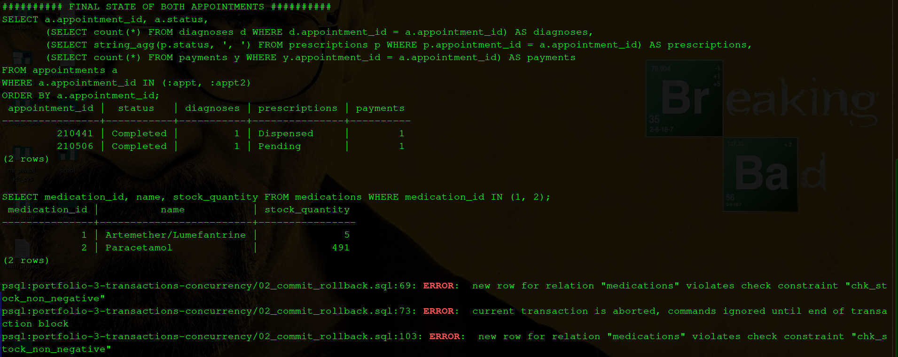
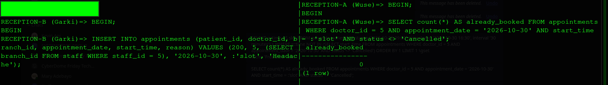
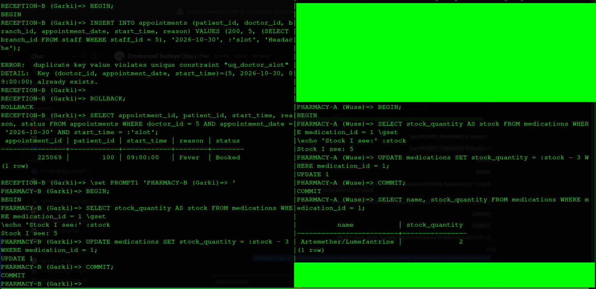
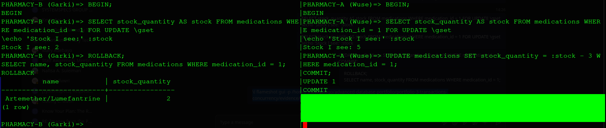
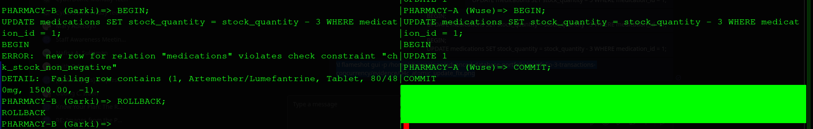
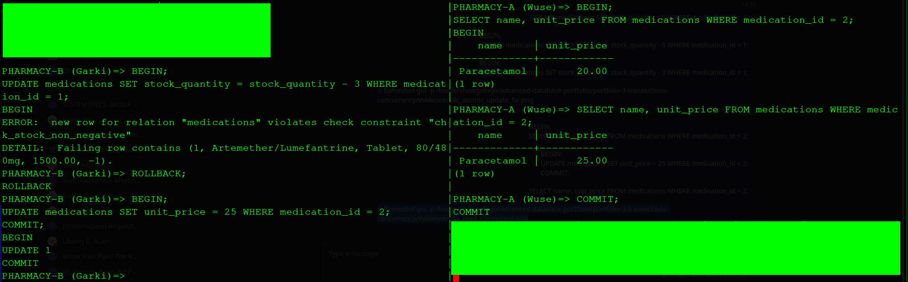
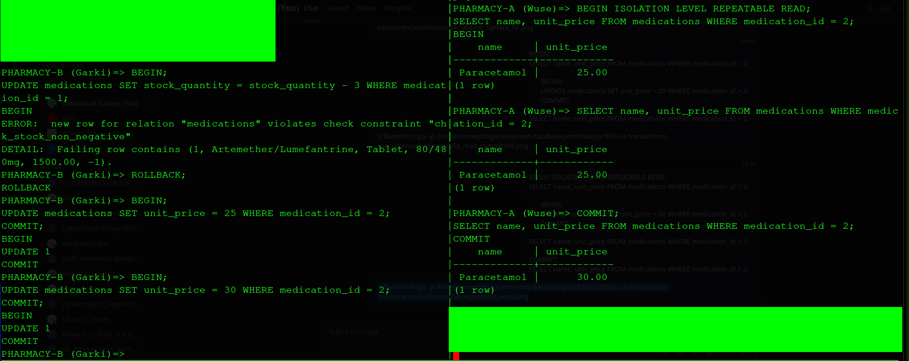

# Portfolio 3: Transactions and Concurrency
 
This portfolio shows how the CarePoint database keeps data correct when (1) a task has several steps that must all succeed together, and (2) several staff members work on the same data at the same time.
 
## Key ideas in plain words
 
- **Transaction:** a group of steps treated as one unit. Either **all** steps are saved (`COMMIT`) or **none** are (`ROLLBACK`).
- **ACID:** the four guarantees a transaction gives:
  - **Atomicity:** all or nothing.
  - **Consistency:** rules (constraints) are never broken.
  - **Isolation:** people working at the same time don't corrupt each other's work.
  - **Durability:** once committed, data survives crashes.
- **Concurrency:** two or more users acting on the same data at the same moment.
- **Lock:** a "please wait" sign the database puts on a row while someone is changing it.
 
## Files in this folder
 
| File | Purpose |
|---|---|
| `01_add_stock.sql` | Migration: adds `stock_quantity` to `medications` (with a rule that stock can never go below zero) |
| `02_commit_rollback.sql` | Script for Demos 1 and 2 (COMMIT, ROLLBACK, SAVEPOINT) |
| `evidence/02_commit_rollback_output.txt` | Full output of the script |
| `evidence/03_session_A.log`, `03_session_B.log` | Text record of the two live sessions used in Demos 3 to 5 |
| `evidence/*.png` | Screenshots of every demo |
 
## Setup for the live demos
 
Demos 3 to 5 used **two database sessions side by side** (using `tmux`), each acting as a different staff member at a different branch:
 
- **Session A:** Wuse branch
- **Session B:** Garki branch
 
Each session's prompt was labelled (e.g. `RECEPTION-A (Wuse)=>`), so the screenshots show clearly who typed what.
 
---
 
## Demo 1: COMMIT (all steps succeed)
 
**Scenario:** a doctor completes a consultation. Six steps must happen together:
 
1. Mark the appointment `Completed`
2. Record the diagnosis
3. Create the prescription
4. Add the drug (9 Paracetamol tablets)
5. Reduce pharmacy stock
6. Record the payment
 
**Result:** all six steps were saved together with `COMMIT`. Appointment 210441 became `Completed`, with a diagnosis, a dispensed prescription and a payment. Paracetamol stock went from **500 to 491**.
 
## Demo 2a: ROLLBACK (one step fails, everything is undone)
 
**Scenario:** a malaria patient is prescribed **10** Artemether/Lumefantrine tablets, but only **5** are in stock.
 
**What happened:**
1. The appointment update, diagnosis and prescription steps all worked.
2. The stock step failed: 5 - 10 = -5, which breaks the rule `chk_stock_non_negative`.
3. PostgreSQL then **refused every further command** ("current transaction is aborted"), including the payment.
4. `ROLLBACK` undid everything.
 
**Result:** the appointment was still `Booked`, with **no** diagnosis, **no** prescription, and stock **still 5**. The half-finished work left no trace.
 
## Demo 2b: SAVEPOINT (undo only the part that failed)
 
**Scenario:** the same patient, but this time a **savepoint** (a bookmark) was placed just before the dispensing steps.
 
**What happened:**
1. The appointment update and diagnosis worked.
2. `SAVEPOINT before_dispensing` was set.
3. The dispensing failed again (not enough stock).
4. `ROLLBACK TO SAVEPOINT` undid **only** the dispensing.
5. The prescription was saved as `Pending` (to be dispensed when stock arrives), the payment was recorded, and everything was committed.
 
**Result:** appointment 210506 is `Completed` with its diagnosis and payment kept, a `Pending` prescription, and stock still 5.
 

 
| Demo | Appointment | Diagnosis | Prescription | Payment | Stock |
|---|---|---|---|---|---|
| 1. COMMIT | Completed | Saved | Dispensed | Saved | Paracetamol 500 to 491 |
| 2a. ROLLBACK | Still Booked | None | None | None | Artemether still 5 |
| 2b. SAVEPOINT | Completed | Saved | Pending | Saved | Artemether still 5 |
 
---
 
## Demo 3: Double-booking race
 
**Scenario:** two receptionists, at Wuse and Garki, try to book **the same doctor at the same time slot** (Dr. 5, 30 Oct 2026, 09:00) for different patients, at the same moment.
 
| Step | RECEPTION-A (Wuse) | RECEPTION-B (Garki) |
|---|---|---|
| 1 | `BEGIN` | |
| 2 | | `BEGIN` |
| 3 | Checks the slot: **0 bookings**, free | |
| 4 | Books patient 100: `INSERT 0 1` (not yet committed) | |
| 5 | | Books patient 200 in the same slot: **waits** |
| 6 | `COMMIT` | |
| 7 | | **ERROR: duplicate key violates unique constraint "uq_doctor_slot"** |
| 8 | | `ROLLBACK` |
 

 

 
**Why B waited:** when A booked the slot, it was reserved in the unique index but not yet committed. PostgreSQL could not know whether A would commit or cancel, so it made B **wait** for A's decision. When A committed, B's booking became a duplicate and was rejected. (Had A cancelled, B's booking would have gone through.)
 
**Why the availability check is not enough:** A's uncommitted booking is invisible to B, so a check by B at step 3 would also have shown the slot as free. (In the recorded session only A ran the check.) Both receptionists can believe the slot is free at the same time. The **unique index from Portfolio 1** is the real protection: the database, not the application, has the final say.
 
**Final result:** exactly one booking (appointment 225069, patient 100).
 
---
 
## Demo 4: The lost update (and two fixes)
 
**Scenario:** two pharmacists each need to dispense **3 packs** of Artemether/Lumefantrine. Only **5** are in stock, so only one of them should succeed.
 
### The problem
 
Their app works the common (but risky) way: **read** the stock, **calculate** the new value, then **write** it back.
 
| Step | PHARMACY-A (Wuse) | PHARMACY-B (Garki) |
|---|---|---|
| 1 | `BEGIN` | `BEGIN` |
| 2 | Reads stock: **5** | Reads stock: **5** |
| 3 | Writes 5 - 3 = 2 | |
| 4 | | Writes 5 - 3 = 2 (waits for A's lock) |
| 5 | `COMMIT` | Update goes through |
| 6 | | `COMMIT` |
 

 
**Result:** stock shows **2**, but **6 packs** left a shelf that held 5. A's update was silently overwritten by B's, because B calculated from an **old reading**. No error was raised: even the "stock cannot be negative" rule could not help, because 2 is a valid number. This is called a **lost update**.
 
### Fix 1: lock the row when reading (`SELECT ... FOR UPDATE`)
 
`FOR UPDATE` means: "I am reading this **because** I am going to change it, so everyone else must wait."
 
| Step | PHARMACY-A (Wuse) | PHARMACY-B (Garki) |
|---|---|---|
| 1 | `BEGIN` | `BEGIN` |
| 2 | Reads and **locks**: stock 5 | |
| 3 | | Tries to read and lock: **waits** |
| 4 | Writes 5 - 3 = 2, `COMMIT` | |
| 5 | | Wakes up and reads **2** (the true value) |
| 6 | | Needs 3, only 2 left: `ROLLBACK` |
 

 
**Result:** stock **2**, exactly 3 packs dispensed. Correct.
 
### Fix 2: let the database do the maths (atomic update)
 
Instead of reading first, each pharmacist writes `stock_quantity = stock_quantity - 3`, which means "take 3 from whatever the stock is **right now**."
 
| Step | PHARMACY-A (Wuse) | PHARMACY-B (Garki) |
|---|---|---|
| 1 | `BEGIN`, stock - 3 (5 to 2) | |
| 2 | | `BEGIN`, stock - 3: **waits** |
| 3 | `COMMIT` | |
| 4 | | Recalculates from the new value: 2 - 3 = -1, **ERROR: violates check constraint "chk_stock_non_negative"** |
| 5 | | `ROLLBACK` |
 

 
**Result:** B was correctly refused. The "no negative stock" rule now works, because B's calculation used the real, current stock.
 
| Approach | What B saw | Packs given out | Correct? |
|---|---|---|---|
| Read, then write | Old value (5) | 6 from a stock of 5 | No: lost update |
| `SELECT ... FOR UPDATE` | Current value (2) | 3 | Yes |
| Atomic update | Current value (2) | 3 | Yes |
 
---
 
## Demo 5: Isolation levels
 
**Question:** in the middle of a task, do you see changes that other people save?
 
**Scenario:** PHARMACY-A prepares a price report and reads the price of Paracetamol **twice**. In between, PHARMACY-B changes the price.
 
### Round 1: READ COMMITTED (PostgreSQL's default)
 
| Step | PHARMACY-A | PHARMACY-B |
|---|---|---|
| 1 | `BEGIN`, reads price: **N20** | |
| 2 | | Changes price to N25, `COMMIT` |
| 3 | Reads again: **N25** | |
 

 
A got **two different answers** to the same question in one task. This is called a **non-repeatable read**.
 
### Round 2: REPEATABLE READ
 
| Step | PHARMACY-A | PHARMACY-B |
|---|---|---|
| 1 | `BEGIN ISOLATION LEVEL REPEATABLE READ`, reads: **N25** | |
| 2 | | Changes price to N30, `COMMIT` |
| 3 | Reads again: **still N25** | |
| 4 | `COMMIT`, reads again: **N30** | |
 

 
A's view was **frozen** at the start of its task, so both readings matched. Once A finished, it saw the latest price.
 
| Isolation level | What you see during your task | Best for |
|---|---|---|
| READ COMMITTED | Always the latest saved data | Bookings, stock checks |
| REPEATABLE READ | A frozen snapshot from when you started | Reports that must add up |
 
(After the demo, the price was set back to N20.)
 
---
 
## Summary: concurrency controls used
 
| Problem | Protection | Demo |
|---|---|---|
| Half-finished workflows | Transactions: `COMMIT` / `ROLLBACK` | 1, 2a |
| Partial failure | `SAVEPOINT` | 2b |
| Double-booking | Unique index + automatic waiting | 3 |
| Lost update | `SELECT ... FOR UPDATE` (row lock) | 4 |
| Lost update | Atomic relative update + CHECK constraint | 4 |
| Inconsistent reports | `REPEATABLE READ` isolation | 5 |
 
## Observations
 
- After any error inside a transaction, PostgreSQL refuses all further commands until `ROLLBACK`. This stops a broken workflow from continuing by accident.
- Checking "is it free?" in the application is never enough under concurrency. The database constraint is the final guard.
- Constraints alone do not prevent lost updates: the value written (2) was valid, but wrong. Locking or atomic updates are needed.
- Waiting (locking) is what keeps data correct, but it also means users can be briefly blocked by each other. Keeping transactions short reduces this.
 
## How to Run
 
From this folder:
 
    psql -U postgres -h localhost -d carepoint -f 01_add_stock.sql
    psql -U postgres -h localhost -d carepoint -a -f 02_commit_rollback.sql
 
Demos 3 to 5 are run live in two sessions, following the step tables above.
