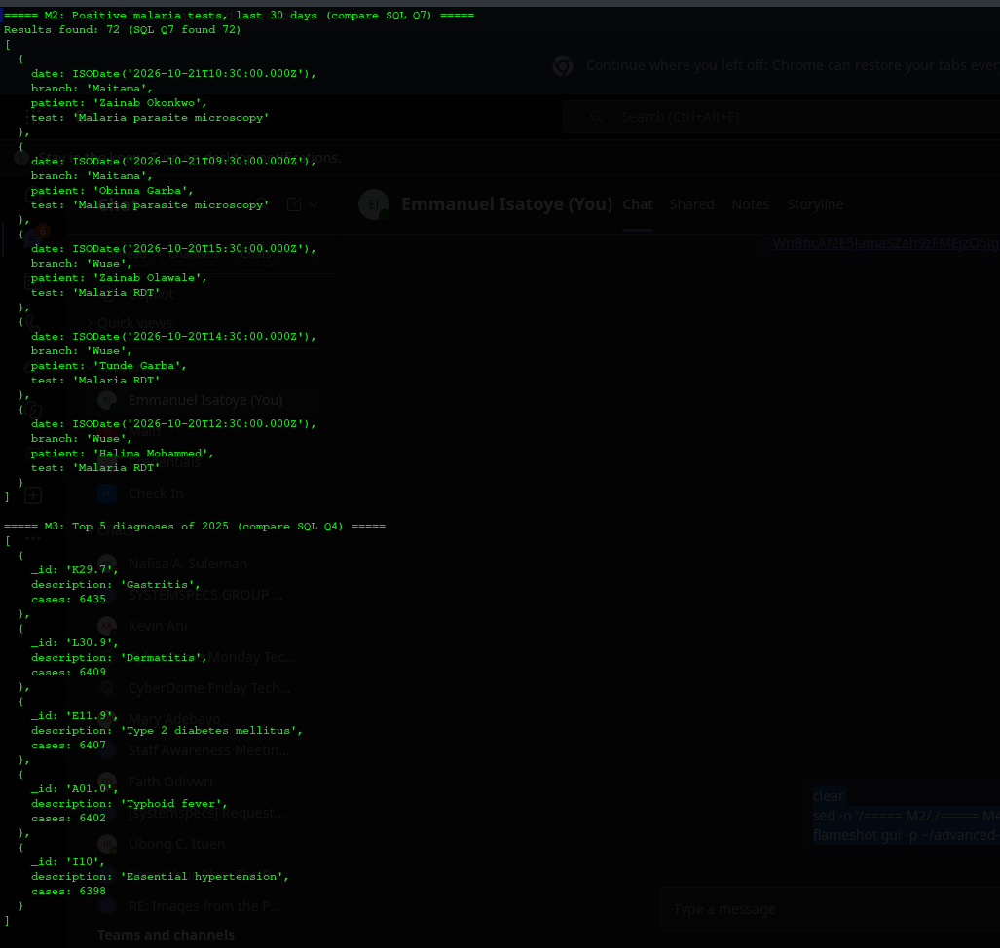
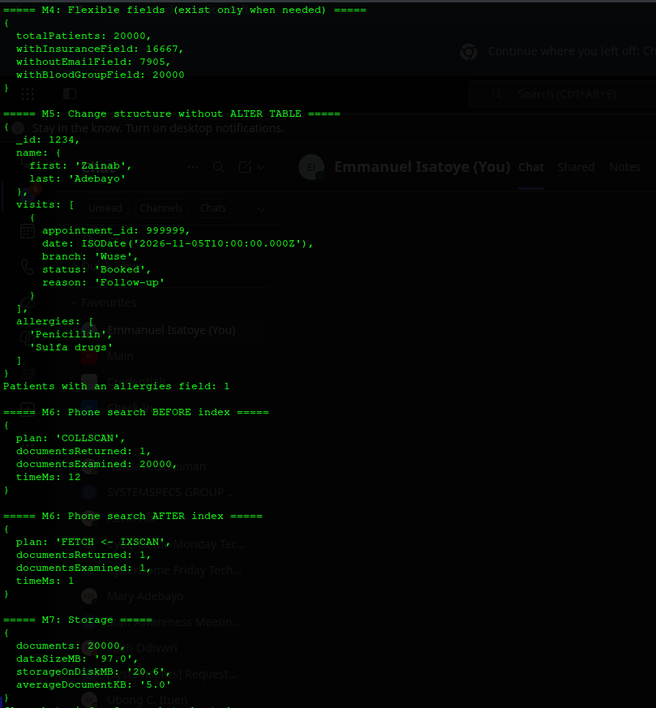

# Portfolio 4: NoSQL and Advanced Data Models
 
This portfolio models the CarePoint clinic data in **MongoDB**, a **document database**, and compares it with the PostgreSQL design from Portfolios 1 to 3.
 
## Key idea in plain words
 
- **PostgreSQL (relational):** data is split into many tables (patients, appointments, diagnoses...) and **joined** when needed.

- **MongoDB (document):** each patient is stored as **one document**, like a complete medical file in a single folder, with their visits **nested inside**.
 
## Files in this folder
 
| File | Purpose |

|---|---|

| `01_export_patient_documents.sql` | Builds one JSON document per patient inside PostgreSQL and exports them |

| `02_queries.js` | MongoDB queries (M1 to M7), run with `mongosh` |

| `evidence/02_mongo_queries_output.txt` | Full output of the queries |

| `evidence/postgres_size.txt` | Size of the same data in PostgreSQL |

| `evidence/*.png` | Screenshots |
 
## Setup
 
MongoDB 8 runs in a Docker container (no installation on the host):
 
    sudo docker run -d --name carepoint-mongo -p 27017:27017 -v carepoint-mongo-data:/data/db mongo:8
 
The `-v` volume keeps the data safe if the container restarts.
 
## 1. Document design
 
Collection: `patient_records`, with **one document per patient** (20,000 documents).
 
```json

{

  "_id": 1234,

  "name": { "first": "Zainab", "last": "Adebayo" },

  "gender": "Female",

  "blood_group": "O+",

  "contact": { "phone": "07030001234", "email": "patient1234@example.com", "address": "Lugbe, Abuja" },

  "registered_branch": "Garki",

  "insurance": { "type": "HMO" },

  "allergies": ["Penicillin", "Sulfa drugs"],

  "visits": [

    {

      "appointment_id": 198143,

      "date": "2026-08-24T10:00:00Z",

      "branch": "Garki",

      "doctor": { "name": "Uche Bello", "specialisation": "Paediatrics" },

      "status": "Completed",

      "diagnosis": { "icd10": "A01.0", "description": "Typhoid fever" },

      "prescriptions": [ { "status": "Dispensed", "items": [ { "drug": "Amoxicillin", "quantity": 10 } ] } ],

      "payment": { "amount": 5000, "method": "Transfer" }

    }

  ]

}

```
 
**Design decisions:**
 
| Decision | Reason |

|---|---|

| **Embed** visits, diagnoses, prescriptions, lab tests and payments inside the patient | They always belong to one patient and are usually read together ("show this patient's history") |

| **Copy** the doctor's name and specialisation into each visit | Avoids a lookup on every read. Trade-off: if a doctor's details change, many documents must be updated |

| **Leave out** empty fields (`json_strip_nulls`) | A visit with no lab test simply has no `lab_tests` field |

| Dates stored as real dates (`ISODate`) | Allows date-range queries |
 
**How the data was moved:** PostgreSQL's JSON functions built the documents (`json_build_object`, `json_agg`), they were exported to a file, and then loaded with `mongoimport`. All **20,000 documents imported, with 0 failures**.
 
## 2. Queries and results
 
| # | Question | MongoDB approach | Result |

|---|---|---|---|

| M1 | Patient history by phone | `findOne` on one document, **no joins** | Full file: 9 visits with prescriptions and payments |

| M2 | Positive malaria tests, last 30 days | Aggregation: `$unwind` visits, `$match`, `$unwind` lab tests | **72**, the same as SQL Q7 in Portfolio 2 |

| M3 | Top 5 diagnoses of 2025 | Aggregation: `$group` and `$sort` | Gastritis 6,435, Dermatitis 6,409... **identical** to SQL Q4 |

| M4 | Which fields exist | `countDocuments` with `$exists` | 16,667 patients have `insurance`; 7,905 have **no** email field |

| M5 | Add allergies and a new visit | `$set`, `$push` | Done instantly, **no `ALTER TABLE`** needed |

| M6 | Phone search with and without an index | `explain("executionStats")` | See below |

| M7 | Storage | `stats()` | See below |
 
M2 and M3 giving **exactly the same results** as PostgreSQL confirms the data was transferred correctly.
 

 
### Index (M6)
 
| | Plan | Documents examined | Time |

|---|---|---|---|

| Before index | `COLLSCAN` (read everything) | 20,000 | 12 ms |

| After `createIndex({"contact.phone": 1})` | `IXSCAN` (jump to the match) | **1** | 1 ms |
 
`COLLSCAN` in MongoDB means the same as `Seq Scan` in PostgreSQL. The lesson from Portfolio 2 applies to both systems.
 
### Storage (M7)
 
| | Size |

|---|---|

| MongoDB data (uncompressed) | 97.0 MB |

| MongoDB on disk (compressed) | **20.6 MB** |

| PostgreSQL, same tables including indexes | 118 MB |
 
MongoDB compresses data on disk automatically. The PostgreSQL figure also includes the indexes from Portfolio 2, so this is not a perfect like-for-like comparison, but it shows the effect of compression.
 

 
## 3. When is the document model a better fit?
 
**MongoDB fits well for:**

- **Reading a whole patient file at once:** one document instead of joining 9 tables.

- **Data that varies between records:** allergies, insurance details or new test types can be added to some patients without changing a schema (M5).

- **Growing fast:** documents are self-contained, so they are easy to spread across servers (see Portfolio 5).
 
**PostgreSQL fits better for:**

- **Booking and stock:** the double-booking and lost-update protections from Portfolio 3 depend on constraints across rows. These are much harder to enforce when data is nested in documents.

- **Reports across all patients:** M2 and M3 had to `$unwind` (unpack) every visit of every patient. SQL tables handle this kind of report naturally.

- **Shared data that changes:** a doctor's name is copied into thousands of visits in MongoDB, but stored once in PostgreSQL.
 
**Conclusion:** for CarePoint, the best design is to keep **PostgreSQL as the main system** (bookings, payments, stock) and use the **document model as a read-optimised copy** of patient records, for example for a doctor's "patient file" screen or a patient mobile app.
 
## 4. Other NoSQL models (brief)
 
| Model | Example | Possible CarePoint use |

|---|---|---|

| Document | MongoDB | Patient files (this portfolio) |

| Key-value | Redis | Fast lookups such as today's queue number per branch, or login sessions |

| Column-family | Cassandra | Very high-volume time series, e.g. readings from patient monitoring devices |

| Graph | Neo4j | Referral networks: which doctors refer patients to which specialists |
 
## Observations
 
- The patient-level `insurance` field was derived simply ("any visit paid by HMO"), which is why 83% of patients have it. A real system would store insurance details from registration.

- `$push` adds new visits at the **end** of the array: MongoDB keeps arrays in insertion order and does not sort them automatically.

- A document must stay under MongoDB's 16 MB limit. A patient with thousands of visits could hit this, so a very long history would need visits split into their own collection.
 
## How to Run
 
From the project root:
 
    psql -U postgres -h localhost -d carepoint -f portfolio-4-nosql/01_export_patient_documents.sql

    sudo docker exec -i carepoint-mongo mongoimport --db carepoint --collection patient_records --drop < /tmp/patient_documents.json

    sudo docker cp portfolio-4-nosql/02_queries.js carepoint-mongo:/tmp/02_queries.js

    sudo docker exec carepoint-mongo mongosh carepoint --quiet --file /tmp/02_queries.js

