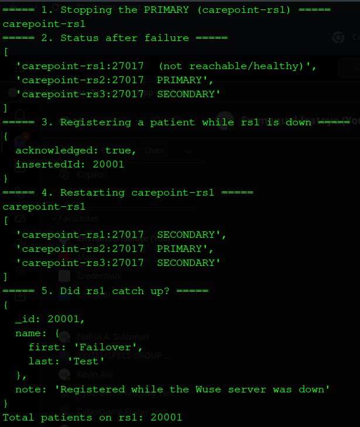
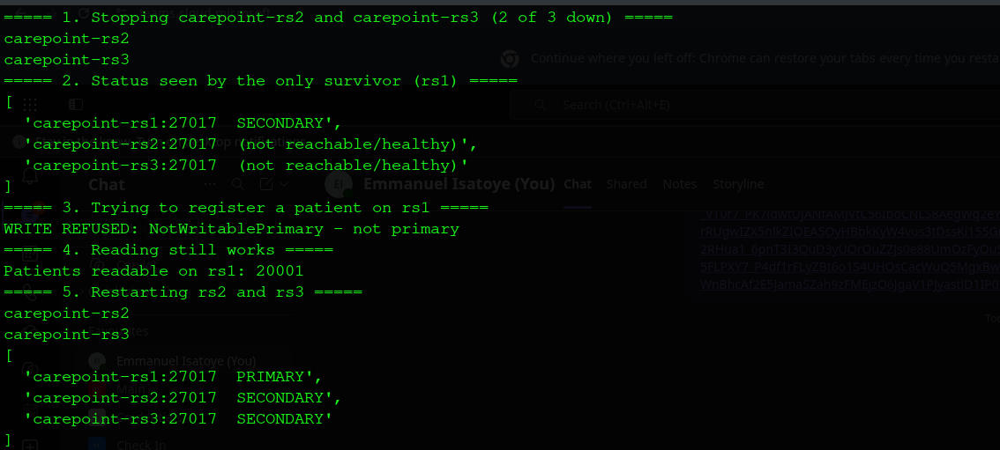

# Portfolio 5: Distributed and Cloud Databases
 
This portfolio runs the CarePoint patient records from Portfolio 4 on **three database servers** that copy each other, and shows what happens when servers fail.
 
## Key ideas in plain words
 
- **Replication:** keeping identical copies of the data on several servers.
- **Primary / secondary:** one server (the **primary**) accepts all writes; the others (**secondaries**) copy them automatically.
- **Failover:** if the primary fails, the remaining servers **vote** and elect a new primary.
- **Majority:** a server may only act as primary if it can reach **more than half** of the servers (2 of 3). This stops two servers from both thinking they are in charge.
- **Sharding:** splitting data across servers so each holds only part of it (discussed below).
 
## Files in this folder
 
| File | Purpose |
|---|---|
| `setup_replica_set.sh` | Creates the 3-node replica set in Docker |
| `evidence/01_replication_counts.txt` | Document counts on all three servers |
| `evidence/02_failover_output.txt`, `02_failover.png` | Primary failure and recovery |
| `evidence/03_majority_lost_output.txt`, `03_majority_lost.png` | Two servers down: writes refused |
 
## Architecture
 
Three MongoDB 8 containers on a private Docker network, one per branch:
 
| Server | Represents | Starting role |
|---|---|---|
| `carepoint-rs1` | Wuse | PRIMARY |
| `carepoint-rs2` | Garki | SECONDARY |
| `carepoint-rs3` | Maitama | SECONDARY |
 
In a real deployment, each server would sit in a different branch or cloud data centre, so one site's power or network failure does not stop the clinic.
 
## Demo 1: Replication
 
The 20,000 patient documents were imported **only into the primary** (rs1). A few seconds later, every server held a full copy:
 
| Server | Documents |
|---|---|
| carepoint-rs1 (primary) | 20,000 |
| carepoint-rs2 (secondary) | 20,000 |
| carepoint-rs3 (secondary) | 20,000 |
 
## Demo 2: Failover (the primary crashes)
 
| Step | What happened |
|---|---|
| 1 | The Wuse server (rs1, primary) was stopped |
| 2 | Within seconds, rs2 and rs3 elected **rs2 (Garki) as the new primary** |
| 3 | A new patient ("Failover Test") was registered **during the outage**, with `writeConcern: majority` (saved on at least 2 servers before confirming) |
| 4 | rs1 was restarted and **rejoined as a secondary** |
| 5 | rs1 automatically **caught up**: it now held the new patient (20,001 total) |
 

 
**Result:** the clinic kept working while a server was down, and no data was lost.
 
## Demo 3: Losing the majority (2 of 3 servers down)
 
| Step | What happened |
|---|---|
| 1 | rs2 and rs3 were stopped |
| 2 | rs1, alone, stayed **SECONDARY**: it could not reach a majority, so it could not become primary |
| 3 | A write was **refused**: `NotWritablePrimary` |
| 4 | Reading still worked: 20,001 patients readable |
| 5 | rs2 and rs3 were restarted and the set recovered with one primary |
 

 
**Why refuse writes?** rs1 cannot tell whether the other two have crashed or are just cut off from it and still running. If it accepted writes, two parts of the system could record conflicting data (a "split brain"). Refusing keeps the data **consistent**, at the cost of **availability** for writes.
 
## Consistency and availability (CAP theorem)
 
When servers cannot talk to each other (a **network partition**), a distributed database must choose between:
- **Consistency:** everyone sees the same, correct data, or
- **Availability:** every request gets an answer, even if the data may be out of date.
 
Demo 3 shows MongoDB choosing **consistency** for writes, while still allowing reads. The application can tune this:
 
| Setting | Effect | CarePoint use |
|---|---|---|
| `writeConcern: majority` | Write confirmed only once on 2 of 3 servers; survives a primary crash | Registrations, payments |
| `writeConcern: 1` | Confirmed by the primary alone; faster, but may be lost if it crashes immediately | Non-critical logs |
| `readPreference: primary` | Always the latest data | Booking screens |
| `readPreference: secondaryPreferred` | Reads from copies; spreads the load, may be slightly behind | Reports, dashboards |
 
## Sharding (design discussion)
 
Replication copies **all** data to every server. **Sharding** splits the data so each server holds only **part** of it, which is needed when the data becomes too large for one server.
 
| Shard key option | Assessment |
|---|---|
| `registered_branch` | Poor: only 3 values, so data cannot be spread evenly, and the busiest branch becomes a hotspot |
| `_id` (patient ID), **hashed** | Good: spreads patients evenly across shards; lookups by patient go straight to one shard |
| Hashed `_id` + **zone sharding** by branch | Best for a larger network: patients registered at a branch are kept on servers near that branch, for faster local access |
 
For CarePoint's current size (20,000 patients, about 21 MB on disk), **replication alone is enough**. Sharding would become worthwhile if the clinic grew to many branches or millions of records.
 
## Cloud deployment (option)
 
The same replica set can be run as a managed cloud service such as **MongoDB Atlas**, which places the three servers in different data centres and handles backups, monitoring and failover automatically. The trade-offs are monthly cost, dependence on internet connectivity, and storing patient data with a third party, which requires attention to data-protection rules such as Nigeria's NDPA.
 
## Observations
 
- Failover took only seconds and required no manual action.
- Three servers is the minimum for automatic failover: with only two, losing one leaves no majority, so no primary can be elected.
- Replication protects against server failure, but **not** against mistakes such as accidentally deleting records, because the deletion is copied too. Regular backups are still needed.
 
## How to Run
 
    ./setup_replica_set.sh
    sudo docker exec -i carepoint-rs1 mongoimport --db carepoint --collection patient_records --drop < /tmp/patient_documents.json
 
Then follow the steps in the demo tables above (`docker stop` / `docker start` the containers).
